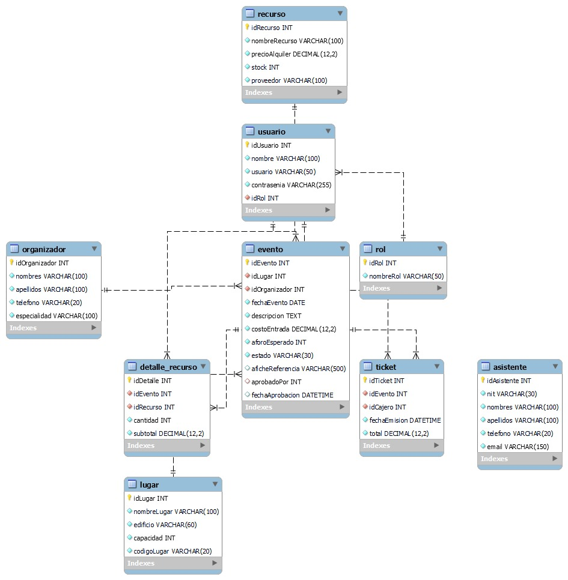

# KinalFest – Sistema de Gestión de Eventos

## Descripción del proyecto

KinalFest es un sistema de gestión de eventos desarrollado en Java, utilizando JavaFX para la interfaz gráfica y MySQL 8.0 para almacenar la información.

El sistema permite administrar eventos, asistentes, organizadores, lugares y recursos. También cuenta con inicio de sesión, diferentes roles de usuario, aprobación de eventos, emisión de tickets y generación de reportes.

## Tecnologías utilizadas

- Java JDK 21
- Apache NetBeans 29
- JavaFX SDK 21
- MySQL 8.0
- MySQL Connector/J 8.0.33
- Java with Ant
- Git y GitHub

## Arquitectura del sistema

El proyecto utiliza la arquitectura **MVC (Modelo-Vista-Controlador)** junto con el patrón **DAO (Data Access Object)**.

- **Model:** contiene las clases que representan las entidades del sistema.
- **View:** contiene las interfaces gráficas desarrolladas en JavaFX y FXML.
- **Controller:** administra las acciones del usuario y la comunicación con las demás capas.
- **DAO:** permite acceder a los datos mediante procedimientos almacenados de MySQL.
- **Util:** contiene clases de apoyo, como la conexión a la base de datos y las alertas.

También se utiliza el patrón Singleton para administrar la conexión y el contexto de sesión.

## Requisitos para ejecutar el proyecto

Antes de ejecutar KinalFest es necesario tener instalado:

1. Java JDK 21.
2. Apache NetBeans 29.
3. MySQL Server 8.0.
4. MySQL Workbench.
5. JavaFX SDK 21.
6. MySQL Connector/J 8.0.33.

## Configuración de la base de datos

Abrir MySQL Workbench y ejecutar los siguientes archivos SQL en orden:

1. `database/01_kinalfest_ddl.sql`
2. `database/02_kinalfest_procedures.sql`
3. `database/03_kinalfest_dml.sql`

Estos archivos permiten crear la estructura de la base de datos, los procedimientos almacenados y los registros de prueba.

**Importante:** el archivo DML debe ejecutarse una sola vez para evitar registros duplicados.

La base de datos utilizada por el sistema se llama `db_kinalfest`.

## Configuración de la conexión MySQL

La aplicación utiliza la clase `Conexion.java`, ubicada en:

`src/org/kinalfest/util/Conexion.java`

La configuración de conexión contempla estas variables de entorno:

- `KINALFEST_DB_URL`
- `KINALFEST_DB_USER`
- `KINALFEST_DB_PASSWORD`

La URL de conexión para una instalación local es:

`jdbc:mysql://localhost:3306/db_kinalfest?useSSL=false&serverTimezone=UTC`

Es necesario configurar un usuario de MySQL con permisos sobre la base de datos.

**Por seguridad, no se deben subir contraseñas personales al repositorio.**

## Ejecución del proyecto en NetBeans

1. Abrir Apache NetBeans 29.
2. Seleccionar **File → Open Project**.
3. Buscar la carpeta del proyecto `KinalFest`.
4. Verificar que el proyecto utilice JDK 21.
5. Configurar la biblioteca `JavaFX21` con los archivos JAR de JavaFX SDK 21.
6. Configurar MySQL Connector/J 8.0.33.
7. Revisar las opciones de ejecución de JavaFX en `nbproject/project.properties`.
8. Verificar que MySQL Server esté funcionando.
9. Ejecutar **Clean and Build**.
10. Ejecutar **Run Project**.

Si la configuración es correcta, se mostrará la ventana de inicio de sesión de KinalFest.

## Funcionalidades del sistema

El sistema incluye los siguientes módulos:

- **Inicio de sesión:** permite acceder al sistema según el usuario y su rol.
- **Gestión de asistentes:** registro, consulta, actualización y eliminación de asistentes.
- **Gestión de lugares:** administración de los espacios disponibles para eventos.
- **Gestión de organizadores:** administración de los organizadores.
- **Gestión de recursos:** control de los recursos utilizados en los eventos.
- **Gestión de eventos:** registro y administración de eventos.
- **Aprobación de eventos:** revisión y aprobación de eventos según los permisos del usuario.
- **Emisión de tickets:** registro de tickets para los eventos.
- **Reportes:** consulta de información y exportación de datos a CSV.

## Diagrama entidad-relación

El diagrama entidad-relación muestra las tablas de la base de datos y sus relaciones.



El archivo se encuentra en:

`database/KinalFest_Diagrama_ER.jpg`

## Estructura del proyecto

```text
KinalFest/
├── database/
│   ├── 01_kinalfest_ddl.sql
│   ├── 02_kinalfest_procedures.sql
│   ├── 03_kinalfest_dml.sql
│   └── KinalFest_Diagrama_ER.jpg
├── src/
│   └── org/
│       └── kinalfest/
│           ├── controller/
│           ├── dao/
│           │   └── impl/
│           ├── exceptions/
│           ├── model/
│           ├── system/
│           ├── util/
│           └── view/
├── nbproject/
├── build.xml
└── README.md
```

## Control de versiones con GitFlow

Para organizar el desarrollo se utiliza GitFlow con las siguientes ramas:

- `master`: versión final del proyecto.
- `develop`: integración de las funcionalidades.
- `feature/architecture`: configuración inicial de la arquitectura.
- `feature/database`: implementación de la base de datos.
- `feature/model-dao`: modelos y acceso a datos.
- `feature/javafx`: interfaces y controladores JavaFX.
- `feature/correcciones`: corrección de errores detectados durante las pruebas.

Los cambios se registran mediante commits y posteriormente se integran a la rama `develop`.

La versión final del proyecto se identificará mediante el tag `v1.0.0` cuando se complete y verifique la entrega.

## Limitaciones y observaciones

- Es necesario comprobar el funcionamiento completo de los módulos antes de la entrega.
- El procedimiento `sp_login` utiliza contraseñas en texto plano, por lo que la configuración actual está destinada a un entorno académico de demostración.
- La emisión de tickets depende de las reglas implementadas en los procedimientos almacenados.
- Se recomienda verificar los permisos de los usuarios y las operaciones de cada módulo.
- Se debe generar y comprobar el archivo JAR ejecutable antes de realizar la entrega final.

## Autoría

Proyecto académico KinalFest, desarrollado con Java, JavaFX y MySQL, utilizando GitFlow para el control de versiones.

Se utilizó asistencia de inteligencia artificial como apoyo durante el desarrollo. El código, la configuración y las funcionalidades deben revisarse y probarse antes de presentar la entrega final.

## Estado del proyecto

Proyecto en proceso de integración y preparación de la versión final `v1.0.0`.